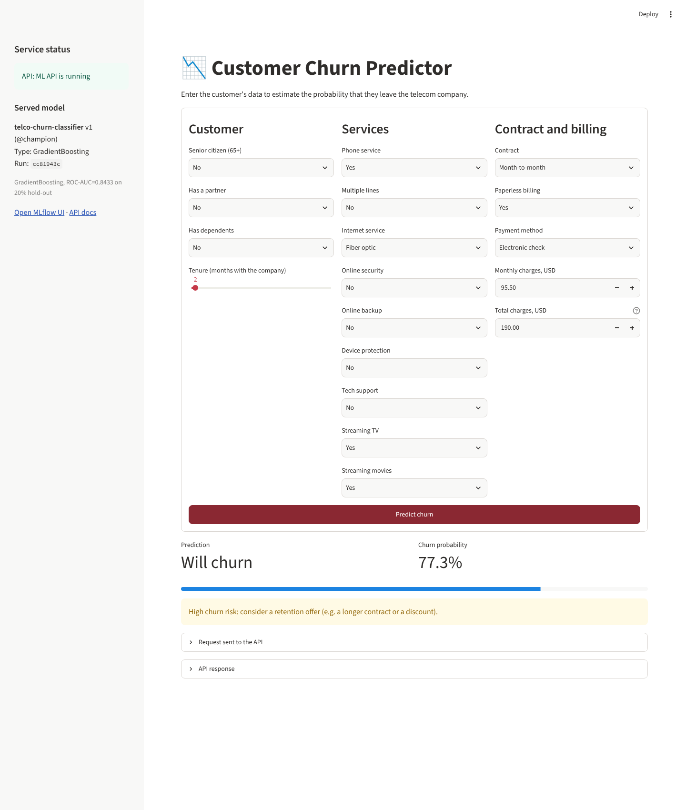
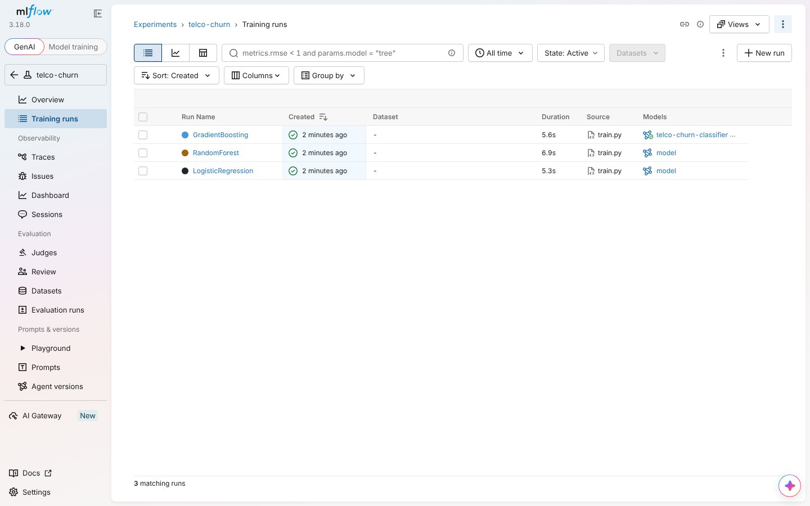
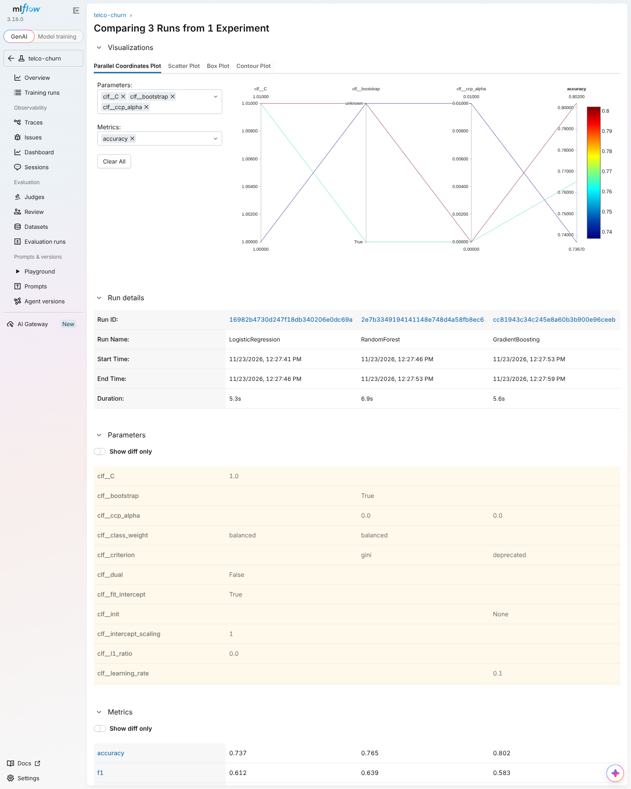
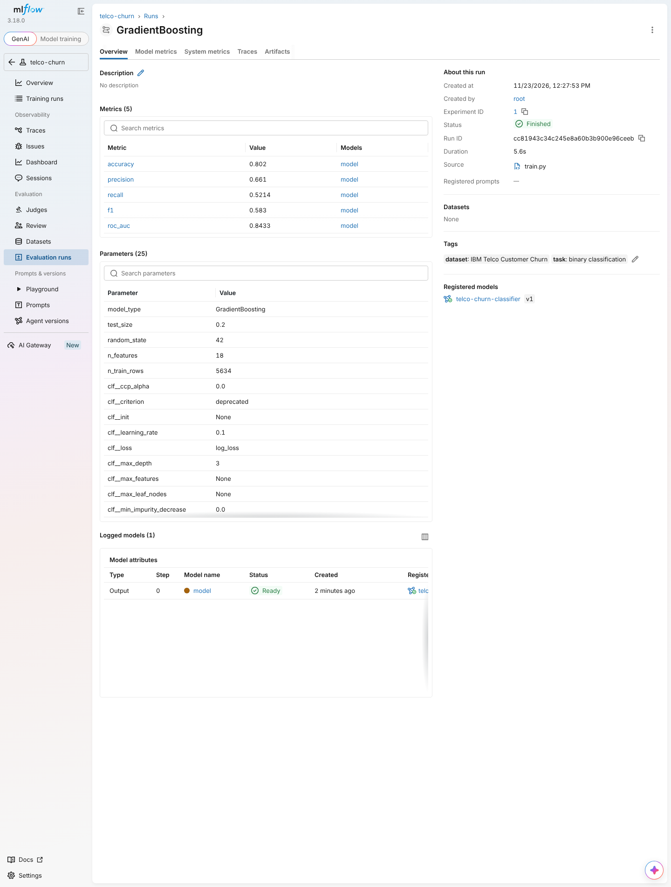
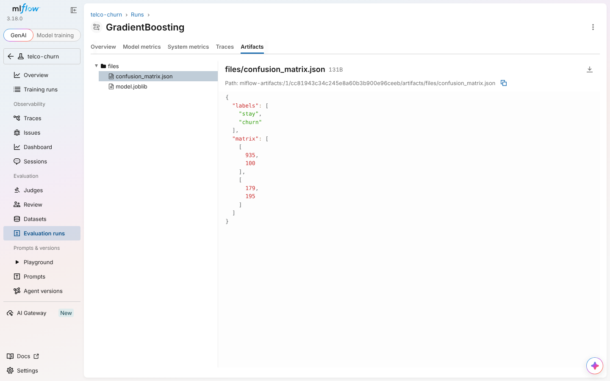
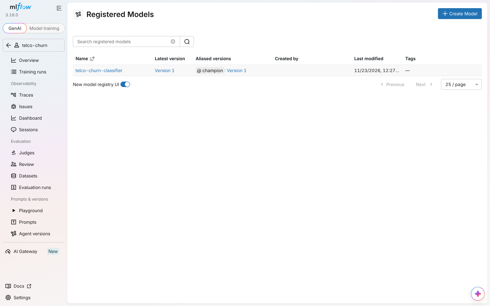
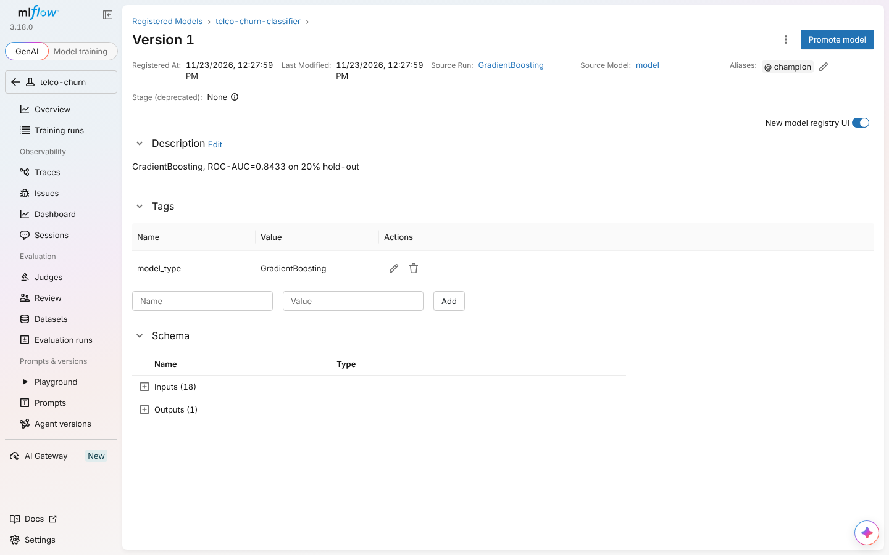

# SIS-3: ML system with Streamlit, FastAPI, MLflow and Docker

Continuation of Practical Task 6. The churn model from Task 6 is extended into a small ML system:

**MLflow**: experiment tracking (parameters, metrics, artifacts) and the **Model Registry**;

**FastAPI**: serves the model that is registered in MLflow;

**Streamlit**: a frontend where a user enters customer data and gets a prediction;

**Docker Compose**: runs all services together.

Dataset: [IBM Telco Customer Churn](https://github.com/IBM/telco-customer-churn-on-icp4d/blob/master/data/Telco-Customer-Churn.csv),
7,043 customers, target `Churn` (26.5% churned). `customerID` and `gender` are not used.

## Architecture

**Training (`train.py`):** Runs the training job, logs metrics and artifacts to MLflow, and registers the best model under `telco-churn-classifier@champion`.

**Tracking & Registry (`MLflow :5000`):** Stores experiment runs and model versions using SQLite and an artifact store.

**Inference API (`FastAPI :8000`):** Pulls `models:/telco-churn-classifier@champion` at startup and serves `/`, `/predict`, `/model-info`, and `/docs`.

**UI (`Streamlit :8501`):** Collects user input via a web form, calls `POST /predict`, and displays the prediction.

## Project structure

```
sis3-ml-system/
├── train.py        
├── main.py                  
├── frontend/
│   ├── app.py               
│   └── requirements.txt
├── Dockerfile                
├── docker/
│   ├── mlflow.Dockerfile    
│   ├── train.Dockerfile      
│   └── frontend.Dockerfile   
├── docker-compose.yml
├── requirements.txt        
├── requirements-dev.txt      
├── data/telco_customer_churn.csv
├── mlflow_data/             
├── model.joblib            
├── metrics.json             
├── tests/test_api.py
└── screenshots/
```

## MLflow integration

### Experiment tracking

`train.py` creates the MLflow experiment **`telco-churn`** and starts one run per model
(LogisticRegression, RandomForest, GradientBoosting). Each run logs:

| What | Details |
|---|---|
| Parameters | `model_type`, `test_size`, `random_state`, `n_features`, `n_train_rows` and **all hyperparameters** of the classifier (`clf__C`, `clf__n_estimators`, `clf__max_depth`, `clf__learning_rate`, ...) |
| Metrics | `accuracy`, `precision`, `recall`, `f1`, `roc_auc` on a stratified 20% hold-out set |
| Artifacts | the MLflow model (sklearn pipeline with input signature and input example), `files/model.joblib` (saved model file), `files/confusion_matrix.json` |
| Tags | `dataset`, `task` |

Results of the runs:

| Run | Accuracy | Precision | Recall | F1 | ROC-AUC |
|---|---|---|---|---|---|
| LogisticRegression | 0.737 | 0.503 | 0.783 | 0.612 | 0.842 |
| RandomForest | 0.765 | 0.540 | 0.783 | **0.639** | 0.842 |
| **GradientBoosting** | **0.802** | **0.661** | 0.521 | 0.583 | **0.843** |

### Model Registry

The run with the best ROC-AUC (GradientBoosting) is registered in the MLflow Model Registry:

- model name: **`telco-churn-classifier`**
- version: **1** (every new `python train.py` creates the next version: 2, 3, ...)
- alias: **`@champion`** points to the version that is served
- version description and tag `model_type` are set

The API loads `models:/telco-churn-classifier@champion`. To deploy another version, move the alias in the
MLflow UI (or with `MlflowClient().set_registered_model_alias(...)`) and restart the API; no code change is needed.

## Run with Docker Compose

```bash
docker compose up -d mlflow

docker compose run --rm train

docker compose up -d --build api frontend
```

| Service | URL |
|---|---|
| Streamlit frontend | http://localhost:8501 |
| FastAPI + Swagger | http://localhost:8000/docs |
| MLflow UI | http://localhost:5000 |

Stop everything: `docker compose down`. MLflow data stays in `./mlflow_data`.

If the API starts before a model is registered, it waits for MLflow a few times and then falls back to the local
`model.joblib`; `GET /model-info` shows which source is used.

## Run locally without Docker

```bash
python -m venv .venv
source .venv/bin/activate              # Windows: .venv\Scripts\activate
pip install -r requirements-dev.txt

# terminal 1: MLflow server
cd mlflow_data
mlflow server --backend-store-uri sqlite:///mlflow.db --artifacts-destination ./artifacts --port 5000

# terminal 2: training + API
python train.py
uvicorn main:app --port 8000

# terminal 3: frontend
streamlit run frontend/app.py
```

Tests: `pytest -q` (6 tests: `/`, `/predict`, a sanity check of the predictions, invalid input → 422, `/docs`, `/model-info`).

## API

| Method | Path | Description |
|---|---|---|
| GET | `/` | `{"message": "ML API is running"}` |
| POST | `/predict` | customer features → `{"prediction": 1, "label": "churn", "churn_probability": 0.7729}` |
| GET | `/model-info` | served model: registry name, version, alias, run id, model type |
| GET | `/docs` | Swagger UI |

Example `/model-info` response:

```json
{"source": "mlflow-registry", "tracking_uri": "http://mlflow:5000", "model_name": "telco-churn-classifier",
 "alias": "champion", "version": 1, "run_id": "cc81943c34c245e8a60b3b900e96ceeb",
 "model_type": "GradientBoosting", "description": "GradientBoosting, ROC-AUC=0.8433 on 20% hold-out"}
```

## Streamlit frontend

The form has three groups (customer, services, contract and billing) with the same allowed values as the API.
After **Predict churn** the page shows the prediction, the churn probability and a short recommendation.
The sidebar shows whether the API is up and which registered model version is being served.

## Screenshots (everything running in Docker Compose)

Streamlit frontend with a prediction:



MLflow experiment `telco-churn` with three runs:



Comparison of the runs (parameters and metrics):



Run overview of the best model (tags, registered model, metrics):



Run artifacts (`model.joblib`, `confusion_matrix.json`):



Model Registry: `telco-churn-classifier`, version 1, alias `@champion`:




